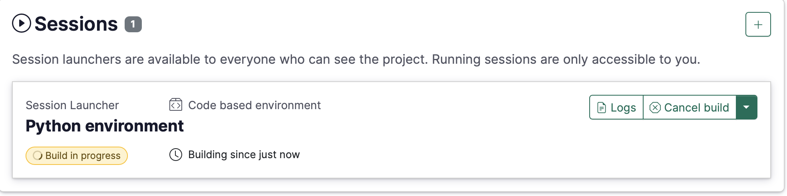
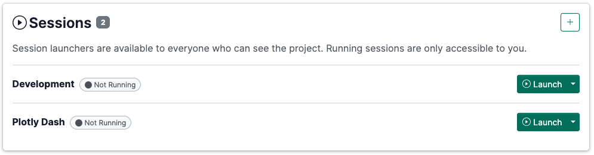

# Create an environment with custom packages installed

If you’d like a set of custom packages to be installed and ready to go when you (or anyone else)
launches a session in your project, you can take advantage of Renku’s **code based environments**.

With Renku code based environments, you can point Renku to a code repository that contains an
environment definition file, such as an `environment.yml`, `requirements.txt`, `pyproject.toml`, or
`renv.lock`, and Renku will build a custom environment for your session for you!

This guide will show you how to create a code-based environment for your project. For the files you can use and how to write them (Python, R and Bioconductor, system packages, Homebrew, init scripts,
VSCodium extensions, coding agents), see [Building environments from
code](/docs/users/compute/environment/build-environment-from-code).

## How to create a code-based environment for your Renku session

:::info

This functionality only works with **public code repositories**. If your code repository is
private, please see [Creating a custom environment from a private code
repository](/docs/users/compute/environment/guides/create-environment-with-custom-packages-private-code-repository).

:::

1. Make sure the code repository that contains your environment definition file is added to your
   Renku project.
2. Create a **new session launcher** by clicking the "+" button in the Launchers section, and select either Session Launcher or Job Launcher.
3. Select the **Create from code** option

   

4. Select the **Code repository**

   :::info

   Note: The code repository must be public. If your code repository is private, please see
   [Creating a custom environment from a private code
   repository](/docs/users/compute/environment/guides/create-environment-with-custom-packages-private-code-repository)

   :::

   :::info

   Note: The code repository must be already linked to the Renku project

   :::

   :::tip

   If your environment definition file is not at the root of the repository, or you want to build
   from a specific branch, tag or commit, open
   [Advanced repository settings](#advanced-repository-settings-optional).

   :::

5. Select the **Environment type**. Choose **Python** for Python environment definition files,
   or **R** for R projects (defined with `environment.yml` or `renv.lock`).
6. Select the **User interface** you’d like your session to have, such as VSCodium/JupyterLab
   for Python environments or RStudio for R environments.
7. Click **Next**
8. Define the **name** of the Session Launcher
9. Select the default **compute resources**
10. Click on **Add launcher**

The environment is now being built by RenkuLab. You can see the status on the session launcher.



When the environment is built, you can launch your session.

### Advanced repository settings (optional)

When selecting the code repository, you can open **Advanced repository settings** to set:

- **Git revision**: the branch, tag or commit to build from. If left empty, the default branch is
  used. Pinning a tag or commit makes the environment reproducible, because later pushes to the
  repository will not change it.
- **Context directory**: the folder (relative to the repository root) where Renku looks for the
  environment definition file, instead of the repository root. Use it when your repository
  contains several environments, or when the environment file lives in a subfolder.

For example, a repository can hold an R analysis environment at the root and a Python dashboard
in a subfolder:

    ```
    ├── environment.yml        # R + Bioconductor → launcher 1 (context directory: empty)
    └── python/
        └── requirements.txt   # Streamlit app → launcher 2 (context directory: python)
    ```

## Updating a code-based environment

1. When you want to make changes to your environment (add new packages), first
   update the environment definition file in the code repository where the
   environment is defined. If your launcher uses a fixed **Git revision** (a tag or commit), update it in the launcher's repository settings to point to the new revision before rebuilding.
2. Then, rebuild the environment in RenkuLab:
   1. Click on the launcher to open the launcher side panel.
   2. Navigate to the **Environment** section.
   3. Click on **Rebuild**.

## [experimental] Using a dashboard with a code-based environment

:::warning

Temporary and experimental! The description below is a current work-around but we will streamline
this workflow in the near future!

:::

Your project might have a nice dashboard inside, which you would want others to see. If your
repository’s requirements include a dashboard tool (e.g. streamlit or plotly dash), it is relatively
simple to have Renku build the image, and convert it to show the dashboard instead of VSCodium. This
way, you can have, for example, one launcher for development that you use and another to show others
the results.

To set up a dashboard with an environment built from your repository, you can follow these steps:

1. Follow the steps for creating a [code-based environment](#how-to-create-a-code-based-environment-for-your-renku-session) above.
2. Once the image is done building, edit the environment and change it to a “Custom Environment”
3. Edit the `Command` to be `["bash", "-c"]` and `Args` to correspond to your app - see common examples [here](/docs/users/compute/environment/guides/use-your-own-docker-image-for-renku-session).

Once you are done, your environment configuration should look something like this:

<p class="image-container-s">

</p>

And your launcher set up could be, for example:



## Creating a code-based environment from a private code repository

Please see [Creating a custom environment from a private code
repository](/docs/users/compute/environment/guides/create-environment-with-custom-packages-private-code-repository).
